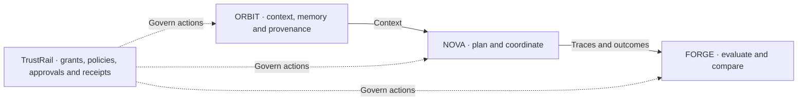
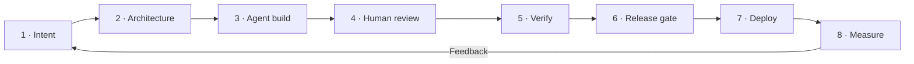

  

<h1 align="center">Yassine Aqejjaj</h1>

<strong>Head of AI · Agentic Platform Architect · Product Builder · Author</strong>

I connect AI strategy, system architecture and hands-on engineering. From enterprise platforms to products that people can use, govern and improve.

  <a href="https://iaseen.com"><strong>Portfolio & experience →</strong></a> &nbsp;·&nbsp;
  <a href="mailto:yassine.aqejjaj@gmail.com"><strong>Get in touch →</strong></a>

## Product constellation

  

Thematic connections across products, platforms, frameworks, programmes and books. Click the image to explore it at full size.

<a href="#agentic-ai-platforms">Agentic AI</a> &nbsp;·&nbsp;
<a href="#how-i-build">Trust &amp; engineering</a> &nbsp;·&nbsp;
<a href="#healthtech">HealthTech</a> &nbsp;·&nbsp;
<a href="#edtech">EdTech</a> &nbsp;·&nbsp;
<a href="#sportech">Sportech</a> &nbsp;·&nbsp;
<a href="#the-books">Publications</a>

<table>
<tr>
<td width="33%" align="center">01 / THE WORK <a href="#featured-work"><strong>Lead · Build · Apply ↓</strong></a></td>
<td width="34%" align="center">02 / THE SYSTEM <a href="#agentic-ai-platforms"><strong>Explore the constellation ↓</strong></a></td>
<td width="33%" align="center">03 / THE IMPACT <a href="#key-results"><strong>See achieved results ↓</strong></a></td>
</tr>
</table>

<a href="#healthtech">HealthTech</a> &nbsp;/&nbsp;
<a href="#edtech">EdTech</a> &nbsp;/&nbsp;
<a href="#sportech">Sportech</a> &nbsp;/&nbsp;
<a href="#the-books">Books</a> &nbsp;/&nbsp;
<a href="#how-i-build">How I build</a>

## Featured work

Three ways I turn ideas into impact.

**DILA · Enterprise delivery.** Reusable sovereign AI architecture, faster RAG delivery and **0.94 answer faithfulness**.  
[Read the case study →](https://iaseen.com/work/dila-sovereign-ai)

**NOVA · Product engineering.** A personal product agent connecting specialist agents, versioned skills and human approval gates, with **42% less execution time**.  
[Try NOVA →](https://nova-six-orcin-96.vercel.app) · [Explore the code](https://github.com/yassineaqejjaj/NOVA) · [Architecture & results](https://github.com/yassineaqejjaj/NOVA/blob/main/docs/PORTFOLIO_CASE_STUDY.md)

**M3aya Santé · Applied AI.** **9/9 care pathways** connected through suggested actions, human approvals and traceable workflows.  
[Explore the demo →](https://carepilot-maroc.vercel.app) · [Watch the walkthrough](https://github.com/user-attachments/assets/f6f8542e-7ebe-4b5e-8892-dd34fc8fe758) · [Code & architecture](https://github.com/yassineaqejjaj/CarePilot)

More enterprise impact · Decathlon & Carrefour

- [**Decathlon — AI-powered retail**](https://iaseen.com/work/decathlon-ai-transformation): **×2.6** augmented productivity, **93%** computer vision precision.
- [**Carrefour — Supply chain intelligence**](https://iaseen.com/work/carrefour-ml-mlops): **+13 pts** fill rate; forecasting WAPE **18% → 12%**.

## Agentic AI platforms

Context, coordination, evaluation and control. **ARIS** adds a standalone, mission-driven enterprise platform to this portfolio.

| Project | What I built | Achieved results | Explore |
|---|---|---|---|
| **ARIS** | Enterprise missions planned as task graphs, executed by specialised agents with human approval gates. First workflow: RFP response preparation. | **7** specialised agents · **26/26** backend tests passed | Private beta · RFP workflow verified with a scripted provider |
| **NOVA** | Agent orchestration with versioned skills, specialist agents, human approvals and editable artifacts. | **800** deployed users · **92%** task success · **−42%** execution time | [Code](https://github.com/yassineaqejjaj/NOVA) · [Demo](https://nova-six-orcin-96.vercel.app) · [Case study](https://github.com/yassineaqejjaj/NOVA/blob/main/docs/PORTFOLIO_CASE_STUDY.md) |
| **ORBIT** | Governed retrieval and memory with access controls, provenance and context budgeting. | **91%** retrieval precision@5 · **−48%** context tokens | [Code](https://github.com/yassineaqejjaj/ORBIT) · [Demo](https://orbit-virid-psi-70.vercel.app) · [Case study](https://github.com/yassineaqejjaj/ORBIT/blob/main/docs/PORTFOLIO_CASE_STUDY.md) |
| **FORGE** | Agent evaluation with versioned scenarios, traces, human reviews and regression gates. | **96%** known regression detection · **89%** LLM–human judge agreement | [Code](https://github.com/yassineaqejjaj/FORGE) · [Demo](https://forge-pied-rho.vercel.app) · [Case study](https://github.com/yassineaqejjaj/FORGE/blob/main/docs/PORTFOLIO_CASE_STUDY.md) |
| **TrustRail** | Grants, policies, human approvals and verifiable receipts for agent actions. | **18 ms** P95 gateway overhead · **100%** policy tests passed | [Code](https://github.com/yassineaqejjaj/TrustRail) · [Demo](https://trustrail-mu.vercel.app) · [Build status](https://github.com/yassineaqejjaj/TrustRail/blob/main/docs/BUILD_STATUS.md) |

View IASEEN Constellation project banners

<table>
<tr><td width="50%"></td><td width="50%"></td></tr>
<tr><td width="50%"></td><td width="50%"></td></tr>
</table>

## HealthTech

Healthcare evaluation, care coordination and wellness. Public demos use synthetic data; each repository documents its deployment scope.

| Project | What it does | Evidence / status |
|---|---|---|
| **[MedGuard AI](https://github.com/yassineaqejjaj/medguard-ai)** | Evaluates healthcare AI applications, records human review and blocks failed release criteria. | [Screenshots & synthetic test workflow](https://github.com/yassineaqejjaj/medguard-ai#see-it-work) · MVP |
| **[M3aya Santé](https://github.com/yassineaqejjaj/CarePilot)** | Administrative patient-journey coordination with suggested actions awaiting human approval. | [Public demo](https://carepilot-maroc.vercel.app) · [Product walkthrough](https://github.com/user-attachments/assets/f6f8542e-7ebe-4b5e-8892-dd34fc8fe758) · Synthetic data |
| **Vita** | AI wellness and prevention coach for iOS and Android: weekly plans from phone and wearable data, with safety guardrails. | Private repository · Complete prototype, not yet launched; not a medical device |

View IASEEN Constellation project banners

<table>
<tr><td width="50%"></td><td width="50%"></td></tr>
<tr><td width="50%"></td></tr>
</table>

## EdTech

AI-supported learning, simulation and practical skills development, with human review and documented limits.

| Project | What it does | Evidence / status |
|---|---|---|
| **[SimuLearn](https://github.com/yassineaqejjaj/SimuLearn)** | Patient conversation practice and cited skills feedback for healthcare trainees. | [Product screens](https://github.com/yassineaqejjaj/SimuLearn#23-parcours-apprenant) · Mock-mode MVP; live integrations not yet validated |
| **[ClassMind](https://github.com/yassineaqejjaj/ClassMind)** | Teacher-reviewed learning analytics and AI-supported mathematics exercises. | [Product screens](https://github.com/yassineaqejjaj/ClassMind#captures-décran) · French collège MVP, fictitious data |
| **[TRAIL Academy](https://github.com/yassineaqejjaj/TRAIL-Academy)** | Professional AI learning platform, modules, assessments and course commerce | In development; external integrations and live payments not validated |
| **[TRAIL Intelligence](https://github.com/yassineaqejjaj/trail-intelligence)** | AI skills intelligence: practice lab, evidence-linked assessments, human review and a verified skills passport, with privacy-preserving team analytics | [Web app](https://trail-intelligence.vercel.app) · In production; the AI evaluator is a keyword heuristic until an LLM is connected, so scores are provisional and uncalibrated |

View IASEEN Constellation project banners

<table>
<tr><td width="50%"></td><td width="50%"></td></tr>
<tr><td width="50%"></td><td width="50%"></td></tr>
</table>

## Sportech

Tools for reviewing athletic performance and exploring race strategy.

| Project | What it does | Evidence / status |
|---|---|---|
| **[Fencing Intelligence](https://github.com/yassineaqejjaj/fencing-intelligence)** | Fencing video annotation and evidence-based performance analysis | [Web preview](https://fencing-intelligence.vercel.app) · Experimental heuristics |
| **[APEX F1 Pitwall](https://github.com/yassineaqejjaj/apex-f1-pitwall)** | Race telemetry, replay, team radio and scenario-based strategy modelling | [Web preview](https://apex-f1-pitwall.vercel.app) · Estimates, not race predictions |

View IASEEN Constellation project banners

<table>
<tr><td width="50%"></td><td width="50%"></td></tr>
</table>

<!-- KPI-RESULTS:start -->
## Key results

Achieved outcomes across enterprise delivery, AI products, education and training.

View all achieved results

| Project | Results |
|---|---|
| [DILA · Sovereign AI Platform](https://iaseen.com/work/dila-sovereign-ai) | **−60%** RAG delivery time reduction · **0.94** Answer faithfulness · **75%** Component reuse rate |
| [Decathlon · AI-Powered Retail](https://iaseen.com/work/decathlon-ai-transformation) | **×2.6** Augmented productivity · **93%** Computer vision precision · **4 M€** Programme scope |
| [Carrefour · Supply Chain Intelligence](https://iaseen.com/work/carrefour-ml-mlops) | **+13 pts** Fill rate improvement · **18% → 12%** Forecasting WAPE · **−35%** Forecast processing time |
| [NOVA Suite](https://github.com/yassineaqejjaj/NOVA) | **800** Deployed users · **92%** Task success rate · **−42%** Task execution time reduction |
| [Nova Agents](https://github.com/yassineaqejjaj/NOVA) | **86%** Task completion rate · **92%** Agent coordination success · **81%** Deliverables accepted without major revision |
| [Nova Context (ORBIT)](https://github.com/yassineaqejjaj/ORBIT) | **99.5%** Temporal context accuracy · **91%** Context retrieval precision@5 · **−48%** Context token reduction |
| [Nova Evals (FORGE)](https://github.com/yassineaqejjaj/FORGE) | **96%** Known regression detection rate · **89%** LLM–human judge agreement · **88%** Automated evaluation coverage |
| ARIS (private beta) | **7** Specialised agents · **26/26** Backend tests passed · RFP workflow verified with a scripted provider |
| [TrustRail](https://github.com/yassineaqejjaj/TrustRail) | **100%** Policy tests passed · **18 ms** P95 gateway overhead · **100%** Audit receipt generation |
| [M3aya Santé](https://github.com/yassineaqejjaj/CarePilot) | **9/9** Care pathways covered · **94%** Workflow test success · **−35%** Administrative time reduction |
| [TRAIL Academy](https://github.com/yassineaqejjaj/TRAIL-Academy) | **18** Learning modules · **82%** Learning completion rate · **70%** Hands-on content |
| [MedGuard AI](https://github.com/yassineaqejjaj/medguard-ai) | **91%** AI–expert evaluation agreement · **96%** Critical issue recall · **100%** Test audit coverage |
| [SimuLearn](https://github.com/yassineaqejjaj/SimuLearn) | **24** Simulation scenarios · **87%** Scenario completion rate · **4.3/5** User experience rating |
| [ClassMind](https://github.com/yassineaqejjaj/ClassMind) | **0.91** Answer faithfulness · **89%** Curriculum alignment · **−40%** Lesson preparation time reduction |
| [Fencing Intelligence](https://github.com/yassineaqejjaj/fencing-intelligence) | **91%** Event detection precision · **−60%** Video review time reduction · **3** Fencing disciplines covered |
| LEAP | **1,500+** Professionals trained · **75+** Training sessions delivered · **4.6/5** Training satisfaction |
| Prompt Arena | **13** Learning paths · **130** Applied challenges · **76%** Challenge success rate |

_Calculation method, scope and measurement period available on request._

<!-- KPI-RESULTS:end -->

## Technical case studies

- [**NOVA — Coordinated execution**](https://github.com/yassineaqejjaj/NOVA/blob/main/docs/PORTFOLIO_CASE_STUDY.md): orchestration, approvals, achieved task outcomes and execution time.
- [**ORBIT — Governed context**](https://github.com/yassineaqejjaj/ORBIT/blob/main/docs/PORTFOLIO_CASE_STUDY.md): retrieval precision, temporal accuracy and context token reduction.
- [**FORGE — Evaluation and regression control**](https://github.com/yassineaqejjaj/FORGE/blob/main/docs/PORTFOLIO_CASE_STUDY.md): evaluation coverage, judge agreement and known regression detection.

## How I build

**Specify → Architect → Build → Review → Verify → Release → Measure.**

I own the architecture, acceptance criteria, code review and release decisions. AI coding tools support implementation; autonomy grows with the checks that demonstrate the work meets the required standard.

- **Define success first:** specify the problem, constraints and acceptance criteria.
- **Keep changes reviewable:** build in small steps with clear module boundaries.
- **Evaluate the whole system:** combine tests, traces, scenario evaluations and human review.
- **Measure after release:** track quality, usage, cost and latency, then feed results into the next iteration.

[**Agentic SDLC framework**](https://github.com/yassineaqejjaj/agentic-sdlc) — autonomy levels, stage contracts, review checklists and release templates.

View the development lifecycle

**Core stack:** Python · TypeScript · FastAPI · LangGraph · Fastify · React · Next.js · PostgreSQL · Docker · GitHub Actions · OpenTelemetry.

## The books

Books by Yassine Aqejjaj, connected to the projects and frameworks in this profile.

### SYMBIOSE

**[Discover SYMBIOSE on Amazon →](https://www.amazon.fr/dp/B0G48PY7S5)**

**Related projects:** [NOVA](https://github.com/yassineaqejjaj/NOVA) · [ORBIT](https://github.com/yassineaqejjaj/ORBIT) · [FORGE](https://github.com/yassineaqejjaj/FORGE) · [ARIS (private)](https://github.com/yassineaqejjaj/ARIS) · [AI SDLC](https://github.com/yassineaqejjaj/agentic-sdlc)

NOVA coordinates agents · ORBIT supplies context and memory · FORGE evaluates · ARIS executes enterprise missions · AI SDLC structures the development lifecycle.

[Explore the book-to-project map →](https://github.com/yassineaqejjaj/agentic-sdlc/blob/main/docs/companion-books.md#symbiose)

<table>
<tr>
<td width="50%"> <strong>Education.</strong> <a href="https://www.amazon.fr/dp/B0CN5PG7LT">Leading with AI: Embracing the Future of Education</a> Code in practice: <a href="https://github.com/yassineaqejjaj/ClassMind">ClassMind</a> · <a href="https://github.com/yassineaqejjaj/SimuLearn">SimuLearn</a> · <a href="https://github.com/yassineaqejjaj/TRAIL-Academy">TRAIL Academy</a></td>
<td width="50%"> <strong>Healthcare.</strong> <a href="https://www.amazon.fr/dp/B0CVB848M6">Leading with AI: A Blueprint for AI-Enhanced Healthcare</a> Code in practice: <a href="https://github.com/yassineaqejjaj/medguard-ai">MedGuard AI</a> · <a href="https://github.com/yassineaqejjaj/CarePilot">M3aya Santé</a> · <a href="https://github.com/yassineaqejjaj/SimuLearn">SimuLearn</a></td>
</tr>
</table>

## Let's talk

<strong>AI leadership. Agentic platforms. Products worth building.</strong>

<a href="mailto:yassine.aqejjaj@gmail.com"><strong>Email me →</strong></a> &nbsp;·&nbsp;
<a href="https://iaseen.com">Explore my experience</a> &nbsp;·&nbsp;
<a href="https://github.com/yassineaqejjaj?tab=repositories">Browse the code</a>

IASEEN · THE INTELLIGENCE UNIVERSE

