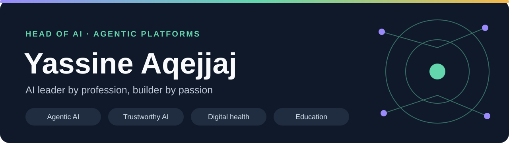
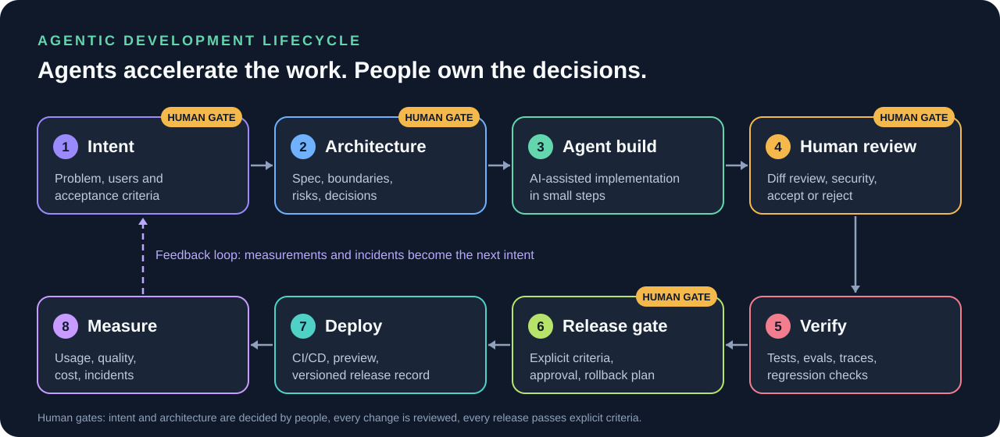

# Yassine Aqejjaj

**Head of AI · Agentic Platform Architect · AI Product Builder**

I turn AI ideas into working software: product strategy, system design, engineering, evaluation and deployment. My focus is **agentic platforms**, **trustworthy AI**, **digital health**, and **education**. I build hands-on with AI coding tools while keeping architectural decisions, review and quality checks under human control.

[**Portfolio · iaseen.com**](https://iaseen.com) · [**My work**](#agentic-ai-platforms) · [**Healthcare & education**](#healthcare--education) · [**Engineering approach**](#how-i-build) · [**Agentic SDLC framework**](https://github.com/yassineaqejjaj/agentic-sdlc) · [**Books**](#the-books) · [**Technical case studies**](#technical-case-studies) · [**All repositories**](https://github.com/yassineaqejjaj?tab=repositories)

## Start here

| If you are... | Go to |
|---|---|
| Leading an AI or engineering team | [Agentic SDLC framework](https://github.com/yassineaqejjaj/agentic-sdlc) · [How I build](#how-i-build) |
| Working in healthcare or education | [Healthcare & education](#healthcare--education) · [The books](#the-books) |
| Looking for agent infrastructure | [NOVA, ORBIT, FORGE and TrustRail](#agentic-ai-platforms) |

## The books

Two books on leading AI adoption, each paired with working code in this profile.

<table>
<tr>
<td width="50%"> <strong>Education.</strong> <a href="https://www.amazon.fr/dp/B0CN5PG7LT">Leading with AI: Embracing the Future of Education</a> Code in practice: <a href="https://github.com/yassineaqejjaj/ClassMind">ClassMind</a> · <a href="https://github.com/yassineaqejjaj/SimuLearn">SimuLearn</a> · <a href="https://github.com/yassineaqejjaj/TRAIL-Academy">TRAIL Academy</a></td>
<td width="50%"> <strong>Healthcare.</strong> <a href="https://www.amazon.fr/dp/B0CVB848M6">Leading with AI: A Blueprint for AI-Enhanced Healthcare</a> Code in practice: <a href="https://github.com/yassineaqejjaj/medguard-ai">MedGuard AI</a> · <a href="https://github.com/yassineaqejjaj/CarePilot">CarePilot</a> · <a href="https://github.com/yassineaqejjaj/SimuLearn">SimuLearn</a></td>
</tr>
</table>

The books set out the leadership view. The repositories are prototypes that test it, with synthetic data and declared limits.

## Agentic AI platforms

An interconnected set of tools. **NOVA acts. ORBIT supplies governed context. FORGE evaluates. TrustRail controls what agents are allowed to do.** Each repository stands on its own, with documented interfaces and limitations.

<table>
<tr><td width="50%">

<strong>NOVA — Agent orchestration</strong>

Versioned skills, specialist agents, approvals and structured artifacts; a documented SDLC flow from issue to PR.

<a href="https://nova-six-orcin-96.vercel.app">Web preview</a> · <a href="https://github.com/yassineaqejjaj/NOVA">Source</a> · <a href="https://github.com/yassineaqejjaj/NOVA/blob/main/docs/PORTFOLIO_CASE_STUDY.md">Case study</a>

</td><td width="50%">

<strong>ORBIT — Context & memory</strong>

Hybrid retrieval, ACL-aware context, versioned memory, provenance, change tracking and token budgeting.

<a href="https://orbit-virid-psi-70.vercel.app">Web preview</a> · <a href="https://github.com/yassineaqejjaj/ORBIT">Source</a> · <a href="https://github.com/yassineaqejjaj/ORBIT/blob/main/docs/PORTFOLIO_CASE_STUDY.md">Case study</a>

</td></tr>
<tr><td width="50%">

<strong>FORGE — Agent evaluation</strong>

Reproducible scenarios, traces, judges, human reviews, regression comparisons and release gates.

<a href="https://forge-pied-rho.vercel.app">Web preview</a> · <a href="https://github.com/yassineaqejjaj/FORGE">Source</a> · <a href="https://github.com/yassineaqejjaj/FORGE/blob/main/docs/PORTFOLIO_CASE_STUDY.md">Case study</a>

</td><td width="50%">
<h3>From intent to evidence</h3>
<pre>NOVA  → plans and executes
  ↓
ORBIT → supplies governed context
  ↓
FORGE → evaluates and compares</pre>

Integrations and production availability vary by version. See each repository's status, setup and test reports before relying on a capability.

<strong>Core tools:</strong> Python, FastAPI, LangGraph, React/TypeScript, Next.js, Fastify, zod, PostgreSQL, Docker, OpenTelemetry and GitHub Actions.

</td></tr>
</table>

**[TrustRail](https://github.com/yassineaqejjaj/TrustRail) — Control over agent actions.** Defines what an AI agent may do on behalf of a person or company (grants, limits, human approvals) and records verifiable receipts. Two use cases on synthetic sandboxes (support refunds, B2B SaaS subscriptions); no real money moves. [Web preview](https://trustrail-mu.vercel.app) · [Build status](https://github.com/yassineaqejjaj/TrustRail/blob/main/docs/BUILD_STATUS.md)

## Healthcare & education

Real code and product interfaces, with **synthetic data and declared limits**. These are prototypes/MVPs, not cleared medical tools or approved systems for student or patient information.

<table>
<tr><td width="50%"></td><td width="50%"></td></tr>
<tr><td width="50%"></td><td width="50%"></td></tr>
<tr><td width="50%"></td></tr>
</table>

| Project | What it does | Evidence / status |
|---|---|---|
| **[MedGuard AI](https://github.com/yassineaqejjaj/medguard-ai)** | Evaluates healthcare AI applications, records human review and blocks failed release criteria. | [Screenshots & synthetic test workflow](https://github.com/yassineaqejjaj/medguard-ai#see-it-work) · MVP |
| **[SimuLearn](https://github.com/yassineaqejjaj/SimuLearn)** | Patient conversation practice and cited skills feedback for healthcare trainees. | [Product screens](https://github.com/yassineaqejjaj/SimuLearn#23-parcours-apprenant) · Mock-mode MVP; live integrations not yet validated |
| **Vita** | AI wellness and prevention coach for iOS and Android: weekly plans from phone and wearable data, with safety guardrails. | Private repository · Complete prototype, not yet launched; not a medical device |
| **[ClassMind](https://github.com/yassineaqejjaj/ClassMind)** | Teacher-reviewed learning analytics and AI-supported mathematics exercises. | [Product screens](https://github.com/yassineaqejjaj/ClassMind#captures-décran) · French collège MVP, fictitious data |
| **[CarePilot](https://github.com/yassineaqejjaj/CarePilot)** | Administrative patient-journey coordination with suggested actions awaiting human approval. | [Product screens](https://github.com/yassineaqejjaj/CarePilot#the-screens) · Local demo only |

## Other product builds

<table>
<tr><td width="50%"></td><td width="50%"></td></tr>
<tr><td width="50%"></td></tr>
</table>

| Product | Purpose | Access |
|---|---|---|
| **[TRAIL Academy](https://github.com/yassineaqejjaj/TRAIL-Academy)** | Professional AI learning platform, modules, assessments and course commerce | In development; external integrations and live payments not validated |
| **[Fencing Intelligence](https://github.com/yassineaqejjaj/fencing-intelligence)** | Fencing video annotation and evidence-based performance analysis | [Web preview](https://fencing-intelligence.vercel.app) · Experimental heuristics |
| **[APEX F1 Pitwall](https://github.com/yassineaqejjaj/apex-f1-pitwall)** | Race telemetry, replay, team radio and scenario-based strategy modelling | [Web preview](https://apex-f1-pitwall.vercel.app) · Estimates, not race predictions |

## Technical case studies

- **[NOVA: from intent to reviewable execution](https://github.com/yassineaqejjaj/NOVA/blob/main/docs/PORTFOLIO_CASE_STUDY.md)** — orchestration, approval gates, versioned deliverables, planned quality checks.
- **[ORBIT: fresh, cited, ACL-aware context](https://github.com/yassineaqejjaj/ORBIT/blob/main/docs/PORTFOLIO_CASE_STUDY.md)** — compare governed context with a basic retrieval baseline; no unverified token-saving claims.
- **[FORGE: baseline versus candidate](https://github.com/yassineaqejjaj/FORGE/blob/main/docs/PORTFOLIO_CASE_STUDY.md)** — synthetic regression demonstration and protocol for reproducible comparison.

The case studies separate **implemented features**, **synthetic demonstrations** and **measurements still to be performed**.

**Portfolio website:** [iaseen.com](https://iaseen.com) · [Source code](https://github.com/yassineaqejjaj/iaseen)

My personal AI portfolio brings together my experience, client case studies, AI products, books and a printable CV.

## How I build

AI coding agents write a large share of the code in my projects. They do not decide what is built, what is accepted or what ships. Every project follows the same loop, with human control points where a mistake would be expensive.

| Stage | What happens | Who decides |
|---|---|---|
| **1. Intent** | Problem, users and written acceptance criteria before any code. Non-goals are listed too. | Me |
| **2. Architecture** | Product spec, module boundaries, data model, risks and decision records. Agents can propose; I choose. | Me |
| **3. Agent build** | Claude Code and similar tools implement in small, reviewable steps against the spec and the tests. | Agent, within the spec |
| **4. Human review** | I read the diff, check security and data handling, and reject what I cannot explain. AI output is a draft, never a result. | Me |
| **5. Verify** | Unit and integration tests, end-to-end checks, and for agent features: scenarios, traces and regression comparisons (the role FORGE plays). | Automated, then me |
| **6. Release gate** | Explicit criteria must pass before release: tests green, known limitations documented, rollback path identified. | Me |
| **7. Deploy** | CI/CD, preview deployments and a versioned release record. | Automated |
| **8. Measure** | Usage, quality, cost and incidents. What I learn becomes the next intent. | Me |

### Earned autonomy

The organizing idea: **an agent earns autonomy where automated checks can prove its work, and loses it where they cannot.** Autonomy is set per stage, not globally.

| Level | The agent may | A human must |
|---|---|---|
| **L0 Suggest** | Propose options and drafts | Decide and write the change |
| **L1 Assist** | Write code in small steps | Review every diff |
| **L2 Delegate** | Complete a scoped task and open a pull request | Review it and pass the gates |
| **L3 Supervise** | Verify and merge to a non-production branch | Audit samples and approve the release |

Irreversible actions and sensitive data are capped at L1, and any incident drops a stage by one level. The full framework, stage contracts, agent-specific risks, metrics and ready-to-use templates (`SPEC.md`, `AGENTS.md`, review checklist, release record) are in **[agentic-sdlc](https://github.com/yassineaqejjaj/agentic-sdlc)**. It is a working v0.1, not an independently validated standard.

### Principles

- **Specification first.** Acceptance criteria and a written spec come before implementation, and the spec is what the agent is held to.
- **Small steps.** Short, reviewable changes beat large generated drops that nobody can verify.
- **Evidence over claims.** A reproducible test or a recorded evaluation counts. A confident description does not.
- **Honest status.** Every repository states what is implemented, what is a synthetic demonstration and what is still unmeasured.
- **Safety by design in health and education.** Synthetic data, declared limits, human approval on consequential actions, and no medical-device claims.
- **Context is engineered.** Governed, cited and permission-aware context (the role ORBIT plays) is treated as part of the system, not as an afterthought.

### Where my own tools fit

NOVA orchestrates the plan and execution, ORBIT supplies governed context, FORGE evaluates results and TrustRail controls what agents are allowed to do. They are my attempt to make this lifecycle repeatable rather than ad hoc.

My interests: agentic applications, context engineering, evaluation, developer productivity and the operating model of AI-enabled teams.
