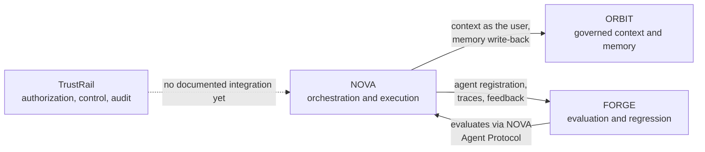

# Yassine Aqejjaj

**Head of AI | Agentic Platform Architect | AI Product Builder**

**From AI Strategy to Working Products.**

Building AI agents, governed context systems, evaluation platforms and real-world AI products.

[**Featured projects**](#featured-projects) · [**Ecosystem**](#agentic-ai-ecosystem) · [**How I build**](#how-i-build) · [**Evidence**](#engineering-evidence) · [**Books**](#the-books) · [**Agentic SDLC**](https://github.com/yassineaqejjaj/agentic-sdlc) · [**LinkedIn**](https://www.linkedin.com/in/yassine-aqejjaj)

## About

I am a Head of AI. I work on AI strategy and transformation, and I build the products that strategy implies. I am not a developer by training: my background is product, strategy and leading teams.

My approach combines product thinking, architecture and hands-on construction. I use AI coding tools such as Claude Code to implement, and I keep problem definition, architecture, review and release decisions under human control. My focus is trustworthy agent platforms and how organizations adopt them, with healthcare and education as the main fields.

## Featured projects

Six products that take AI from strategy to something that runs. Statuses are quoted from each repository, not upgraded.

<table>
<tr>
<td width="50%" valign="top">

<strong>NOVA</strong>: Agent orchestration.

<strong>Problem.</strong> Teams need AI that delivers reviewable work, not only chat answers.

<strong>Verified features.</strong> Intent, planning, specialist agents, approvals, versioned deliverables; an engineering flow from issue to pull request.

<strong>Stack.</strong> Python, FastAPI, LangGraph, Celery, PostgreSQL, Next.js

<strong>Status.</strong> Public beta (per the repository).

<a href="https://nova-six-orcin-96.vercel.app">Demo</a> · <a href="https://github.com/yassineaqejjaj/NOVA">Source</a> · <a href="https://github.com/yassineaqejjaj/NOVA/blob/main/docs/ARCHITECTURE.md">Architecture</a> · <a href="https://github.com/yassineaqejjaj/NOVA/blob/main/docs/STATUS.md">Status matrix</a>

</td>
<td width="50%" valign="top">

<strong>ORBIT (Nova Context)</strong>: Governed context and memory.

<strong>Problem.</strong> Agents need context that is fresh, cited and respects who may see what.

<strong>Verified features.</strong> Multi-source ingestion, versioned memory with review, permission-aware context assembly with citations, REST API and MCP server.

<strong>Stack.</strong> Python, FastAPI, PostgreSQL, Next.js

<strong>Status.</strong> Public beta, not validated for production use (per the repository).

<a href="https://orbit-virid-psi-70.vercel.app">Demo</a> · <a href="https://github.com/yassineaqejjaj/ORBIT">Source</a> · <a href="https://github.com/yassineaqejjaj/ORBIT/blob/main/docs/ARCHITECTURE.md">Architecture</a>

</td>
</tr>
<tr>
<td width="50%" valign="top">

<strong>FORGE (Nova Evals)</strong>: Agent evaluation and reliability.

<strong>Problem.</strong> Is the new version of an agent really better, on which scenarios, at what cost?

<strong>Verified features.</strong> Scenarios, traces, judges, human review, baseline-versus-candidate comparison and release gates.

<strong>Stack.</strong> Python, FastAPI, PostgreSQL, Next.js, OpenTelemetry

<strong>Status.</strong> Public beta; results depend on the configured scenarios (per the repository).

<a href="https://forge-pied-rho.vercel.app">Demo</a> · <a href="https://github.com/yassineaqejjaj/FORGE">Source</a> · <a href="https://github.com/yassineaqejjaj/FORGE/blob/main/docs/ARCHITECTURE.md">Architecture</a>

</td>
<td width="50%" valign="top">

<strong>TrustRail</strong>: Agent authorization and action governance.

<strong>Problem.</strong> Companies cannot safely let agents act without limits, approvals and evidence.

<strong>Verified features.</strong> Delegated grants, deterministic policies, human approval queue, signed receipts, TypeScript and Python SDKs, MCP adapter.

<strong>Stack.</strong> TypeScript, Fastify, Next.js, PostgreSQL, Python SDK

<strong>Status.</strong> Prototype; synthetic sandboxes, no real money moves.

<a href="https://trustrail-mu.vercel.app">Demo</a> · <a href="https://github.com/yassineaqejjaj/TrustRail">Source</a> · <a href="https://github.com/yassineaqejjaj/TrustRail/blob/main/docs/ARCHITECTURE.md">Architecture</a> · <a href="https://github.com/yassineaqejjaj/TrustRail/blob/main/docs/BUILD_STATUS.md">Build status</a>

</td>
</tr>
<tr>
<td width="50%" valign="top">

<strong>TRAIL Academy</strong>: AI education platform.

<strong>Problem.</strong> Professionals need structured, applied training to lead with AI.

<strong>Verified features.</strong> Modules, quizzes, assessments, enterprise paths; Stripe checkout validated in test mode.

<strong>Stack.</strong> Next.js 16, React 19, TypeScript, PostgreSQL

<strong>Status.</strong> Live in test mode; real payments are not open and no video has been uploaded yet (per the repository).

<a href="https://trailacademy.fr">Site</a> · <a href="https://github.com/yassineaqejjaj/TRAIL-Academy">Source</a> · <a href="https://github.com/yassineaqejjaj/TRAIL-Academy/blob/main/ARCHITECTURE.md">Architecture</a> · <a href="https://github.com/yassineaqejjaj/TRAIL-Academy/blob/main/TESTING.md">Testing</a>

</td>
<td width="50%" valign="top">

<strong>M3aya Santé (repository: CarePilot)</strong>: Patient-journey coordination.

<strong>Problem.</strong> Clinics lose time coordinating administrative steps across a patient's care journey.

<strong>Verified features.</strong> Journey cockpit, validation queue, journey designer, analytics; suggested actions wait for human approval.

<strong>Stack.</strong> See the repository README

<strong>Status.</strong> MVP with fictional data; not for use with real patients (per the repository).

<a href="https://carepilot-maroc.vercel.app">Demo</a> · <a href="https://github.com/yassineaqejjaj/CarePilot">Source</a> · <a href="https://github.com/yassineaqejjaj/CarePilot#remaining-work-before-use-with-real-patients">Limits</a>

</td>
</tr>
</table>

## Agentic AI ecosystem

How the platforms relate. Solid arrows are implemented links documented in NOVA's [status matrix](https://github.com/yassineaqejjaj/NOVA/blob/main/docs/STATUS.md); dashed arrows are not an implemented integration.

NOVA retrieves context from ORBIT as the user and is evaluated by FORGE. TrustRail is a standalone product today; connecting it to the other three is a direction, not a feature. Production availability varies by version: see each repository's status.

## More products: healthcare, education and beyond

Real code and product interfaces, with **synthetic data and declared limits**. These are prototypes/MVPs, not cleared medical tools or approved systems for student or patient information.

<table>
<tr><td width="50%"></td><td width="50%"></td></tr>
<tr><td width="50%"></td><td width="50%"></td></tr>
<tr><td width="50%"></td></tr>
</table>

| Project | What it does | Evidence / status |
|---|---|---|
| **[MedGuard AI](https://github.com/yassineaqejjaj/medguard-ai)** | Evaluates healthcare AI applications, records human review and blocks failed release criteria. | [Screenshots & synthetic test workflow](https://github.com/yassineaqejjaj/medguard-ai#see-it-work) · MVP |
| **[SimuLearn](https://github.com/yassineaqejjaj/SimuLearn)** | Patient conversation practice and cited skills feedback for healthcare trainees. | [Product screens](https://github.com/yassineaqejjaj/SimuLearn#23-parcours-apprenant) · Mock-mode MVP; live integrations not yet validated |
| **Vita** | AI wellness and prevention coach for iOS and Android: weekly plans from phone and wearable data, with safety guardrails. | Private repository · Complete prototype, not yet launched; not a medical device |
| **[ClassMind](https://github.com/yassineaqejjaj/ClassMind)** | Teacher-reviewed learning analytics and AI-supported mathematics exercises. | [Product screens](https://github.com/yassineaqejjaj/ClassMind#captures-décran) · French collège MVP, fictitious data |
| **[CarePilot](https://github.com/yassineaqejjaj/CarePilot)** | Administrative patient-journey coordination with suggested actions awaiting human approval. | [Product screens](https://github.com/yassineaqejjaj/CarePilot#the-screens) · Local demo only |

## Other product builds

<table>
<tr><td width="50%"></td><td width="50%"></td></tr>
<tr><td width="50%"></td></tr>
</table>

| Product | Purpose | Access |
|---|---|---|
| **[TRAIL Academy](https://github.com/yassineaqejjaj/TRAIL-Academy)** | Professional AI learning platform, modules, assessments and course commerce | In development; external integrations and live payments not validated |
| **[Fencing Intelligence](https://github.com/yassineaqejjaj/fencing-intelligence)** | Fencing video annotation and evidence-based performance analysis | [Web preview](https://fencing-intelligence.vercel.app) · Experimental heuristics |
| **[APEX F1 Pitwall](https://github.com/yassineaqejjaj/apex-f1-pitwall)** | Race telemetry, replay, team radio and scenario-based strategy modelling | [Web preview](https://apex-f1-pitwall.vercel.app) · Estimates, not race predictions |

## How I build

AI coding agents write a large share of the code in my projects. They do not decide what is built, what is accepted or what ships. Every project follows the same loop, with human control points where a mistake would be expensive.

| Stage | What happens | Who decides |
|---|---|---|
| **1. Intent** | Problem, users and written acceptance criteria before any code. Non-goals are listed too. | Me |
| **2. Architecture** | Product spec, module boundaries, data model, risks and decision records. Agents can propose; I choose. | Me |
| **3. Agent build** | Claude Code and similar tools implement in small, reviewable steps against the spec and the tests. | Agent, within the spec |
| **4. Human review** | I read the diff, check security and data handling, and reject what I cannot explain. AI output is a draft, never a result. | Me |
| **5. Verify** | Unit and integration tests, end-to-end checks, and for agent features: scenarios, traces and regression comparisons (the role FORGE plays). | Automated, then me |
| **6. Release gate** | Explicit criteria must pass before release: tests green, known limitations documented, rollback path identified. | Me |
| **7. Deploy** | CI/CD, preview deployments and a versioned release record. | Automated |
| **8. Measure** | Usage, quality, cost and incidents. What I learn becomes the next intent. | Me |

### Earned autonomy

The organizing idea: **an agent earns autonomy where automated checks can prove its work, and loses it where they cannot.** Autonomy is set per stage, not globally.

| Level | The agent may | A human must |
|---|---|---|
| **L0 Suggest** | Propose options and drafts | Decide and write the change |
| **L1 Assist** | Write code in small steps | Review every diff |
| **L2 Delegate** | Complete a scoped task and open a pull request | Review it and pass the gates |
| **L3 Supervise** | Verify and merge to a non-production branch | Audit samples and approve the release |

Irreversible actions and sensitive data are capped at L1, and any incident drops a stage by one level. The full framework, stage contracts, agent-specific risks, metrics and ready-to-use templates (`SPEC.md`, `AGENTS.md`, review checklist, release record) are in **[agentic-sdlc](https://github.com/yassineaqejjaj/agentic-sdlc)**. It is a working v0.1, not an independently validated standard.

### Principles

- **Specification first.** Acceptance criteria and a written spec come before implementation, and the spec is what the agent is held to.
- **Small steps.** Short, reviewable changes beat large generated drops that nobody can verify.
- **Evidence over claims.** A reproducible test or a recorded evaluation counts. A confident description does not.
- **Honest status.** Every repository states what is implemented, what is a synthetic demonstration and what is still unmeasured.
- **Safety by design in health and education.** Synthetic data, declared limits, human approval on consequential actions, and no medical-device claims.
- **Context is engineered.** Governed, cited and permission-aware context (the role ORBIT plays) is treated as part of the system, not as an afterthought.

### Where my own tools fit

NOVA orchestrates the plan and execution, ORBIT supplies governed context, FORGE evaluates results and TrustRail controls what agents are allowed to do. They are my attempt to make this lifecycle repeatable rather than ad hoc.

My interests: agentic applications, context engineering, evaluation, developer productivity and the operating model of AI-enabled teams.

## Technical capabilities

Only capabilities backed by a project in this profile.

| Capability | Demonstrated in |
|---|---|
| Agentic AI and multi-agent orchestration | [NOVA](https://github.com/yassineaqejjaj/NOVA) |
| RAG and context engineering | [ORBIT](https://github.com/yassineaqejjaj/ORBIT) |
| AI evaluation and observability | [FORGE](https://github.com/yassineaqejjaj/FORGE), [MedGuard AI](https://github.com/yassineaqejjaj/medguard-ai) |
| AI security and governance | [TrustRail](https://github.com/yassineaqejjaj/TrustRail), [MedGuard AI](https://github.com/yassineaqejjaj/medguard-ai) |
| Full-stack product development | [TRAIL Academy](https://github.com/yassineaqejjaj/TRAIL-Academy), [ClassMind](https://github.com/yassineaqejjaj/ClassMind), [CarePilot](https://github.com/yassineaqejjaj/CarePilot) |
| CI/CD and cloud deployment | GitHub Actions workflows and hosted demos on the featured projects |
| AI product management | [Agentic SDLC framework](https://github.com/yassineaqejjaj/agentic-sdlc) and the [case studies](https://github.com/yassineaqejjaj/agentic-sdlc#case-studies) |

## Engineering evidence

Quality over volume. Each repository separates what is implemented, what is tested and what has never been run.

| Evidence | Where to look |
|---|---|
| Automated CI | Workflows in each repository; the badge on each README shows the current run |
| Documented architectures | NOVA, ORBIT, FORGE, TrustRail and TRAIL Academy each link an architecture document |
| Implemented / tested / deployed matrix | [NOVA status](https://github.com/yassineaqejjaj/NOVA/blob/main/docs/STATUS.md) |
| Honest build status | [TrustRail build status](https://github.com/yassineaqejjaj/TrustRail/blob/main/docs/BUILD_STATUS.md), TRAIL Academy's "verified and not verified" section |
| Defects found by running the real thing | [Ten case studies](https://github.com/yassineaqejjaj/agentic-sdlc#case-studies) with cited commits |
| Live demonstrations | NOVA, ORBIT, FORGE, TrustRail, TRAIL Academy, M3aya Santé |
| Known limits | Each README's status and limitations section; see also the [portfolio audit](docs/PORTFOLIO_AUDIT.md) |

Test counts quoted in repositories are theirs and were not re-run for this profile. Known open issue: Fencing Intelligence currently fails its CI; see the audit.

## The books

Two books on leading AI adoption, each paired with working code in this profile.

<table>
<tr>
<td width="50%"> <strong>Education.</strong> <a href="https://www.amazon.fr/dp/B0CN5PG7LT">Leading with AI: Embracing the Future of Education</a> Code in practice: <a href="https://github.com/yassineaqejjaj/ClassMind">ClassMind</a> · <a href="https://github.com/yassineaqejjaj/SimuLearn">SimuLearn</a> · <a href="https://github.com/yassineaqejjaj/TRAIL-Academy">TRAIL Academy</a></td>
<td width="50%"> <strong>Healthcare.</strong> <a href="https://www.amazon.fr/dp/B0CVB848M6">Leading with AI: A Blueprint for AI-Enhanced Healthcare</a> Code in practice: <a href="https://github.com/yassineaqejjaj/medguard-ai">MedGuard AI</a> · <a href="https://github.com/yassineaqejjaj/CarePilot">CarePilot</a> · <a href="https://github.com/yassineaqejjaj/SimuLearn">SimuLearn</a></td>
</tr>
</table>

The books set out the leadership view. The repositories are prototypes that test it, with synthetic data and declared limits.

## Publications and thought leadership

- **[Leading with AI: Embracing the Future of Education](https://www.amazon.fr/dp/B0CN5PG7LT)** and **[Leading with AI: A Blueprint for AI-Enhanced Healthcare](https://www.amazon.fr/dp/B0CVB848M6)**. The books give the leadership view; the healthcare and education projects below test it with synthetic data.
- **[Agentic SDLC framework](https://github.com/yassineaqejjaj/agentic-sdlc)**: autonomy levels, stage contracts, agent-specific risks and ten case studies.

## Connect and collaborate

- LinkedIn: [yassine-aqejjaj](https://www.linkedin.com/in/yassine-aqejjaj)
- GitHub: [yassineaqejjaj](https://github.com/yassineaqejjaj)
- TRAIL Academy: [trailacademy.fr](https://trailacademy.fr)
- Books: [Education](https://www.amazon.fr/dp/B0CN5PG7LT) · [Healthcare](https://www.amazon.fr/dp/B0CVB848M6)
