

  <a href="https://iaseen.com">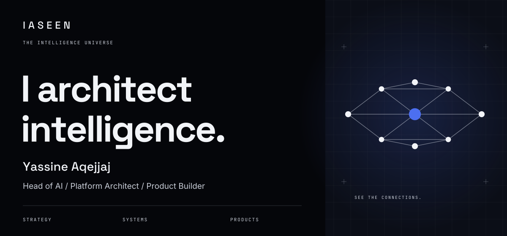</a>

<h1 align="center">Yassine Aqejjaj</h1>

<strong>Head of AI · Agentic Platform Architect · Product Builder · Author</strong>

I connect AI strategy, system architecture and hands-on engineering. From enterprise platforms to products that people can use, govern and improve.

  <a href="https://iaseen.com"><strong>Portfolio & experience →</strong></a> &nbsp;·&nbsp;
  <a href="mailto:yassine.aqejjaj@gmail.com"><strong>Get in touch →</strong></a>

## Product constellation

  <a href="docs/assets/homepage/product-constellation.png">
    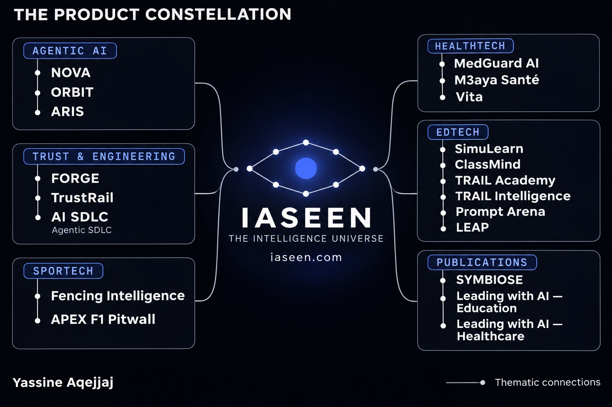
  </a>

Thematic connections across products, platforms, frameworks, programmes and books. Click the image to explore it at full size.

<a href="#agentic-ai-platforms">Agentic AI</a> &nbsp;·&nbsp;
<a href="#how-i-build">Trust &amp; engineering</a> &nbsp;·&nbsp;
<a href="#healthtech">HealthTech</a> &nbsp;·&nbsp;
<a href="#edtech">EdTech</a> &nbsp;·&nbsp;
<a href="#sportech">Sportech</a> &nbsp;·&nbsp;
<a href="#the-books">Publications</a>

<table align="center">
<tr>
<td align="center" width="33%">01 / THE WORK <a href="#featured-work"><strong>Lead · Build · Apply ↓</strong></a></td>
<td align="center" width="34%">02 / THE SYSTEM <a href="#agentic-ai-platforms"><strong>Explore the constellation ↓</strong></a></td>
<td align="center" width="33%">03 / THE IMPACT <a href="#key-results"><strong>See achieved results ↓</strong></a></td>
</tr>
</table>

<a href="#healthtech">HealthTech</a> &nbsp;/&nbsp;
<a href="#edtech">EdTech</a> &nbsp;/&nbsp;
<a href="#sportech">Sportech</a> &nbsp;/&nbsp;
<a href="#the-books">Books</a> &nbsp;/&nbsp;
<a href="#how-i-build">How I build</a>

## Featured work

Three ways I turn ideas into impact.

<a href="https://iaseen.com/work/dila-sovereign-ai">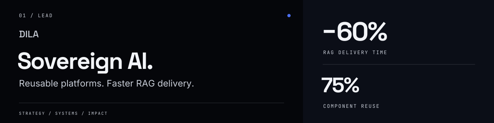</a>

**DILA · Enterprise delivery.** Reusable sovereign AI architecture, faster RAG delivery and **0.94 answer faithfulness**.  
[Read the case study →](https://iaseen.com/work/dila-sovereign-ai)

<a href="https://github.com/yassineaqejjaj/NOVA">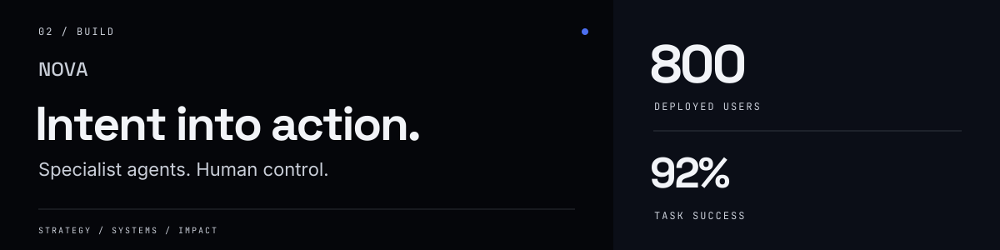</a>

**NOVA · Product engineering.** A personal product agent connecting specialist agents, versioned skills and human approval gates, with **42% less execution time**.  
[Try NOVA →](https://nova-six-orcin-96.vercel.app) · [Explore the code](https://github.com/yassineaqejjaj/NOVA) · [Architecture & results](https://github.com/yassineaqejjaj/NOVA/blob/main/docs/PORTFOLIO_CASE_STUDY.md)

<a href="https://carepilot-maroc.vercel.app">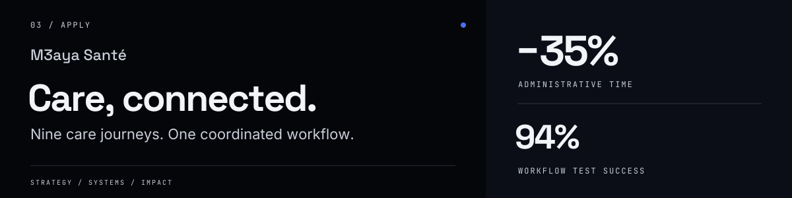</a>

**M3aya Santé · Applied AI.** **9/9 care pathways** connected through suggested actions, human approvals and traceable workflows.  
[Explore the demo →](https://carepilot-maroc.vercel.app) · [Watch the walkthrough](https://github.com/user-attachments/assets/f6f8542e-7ebe-4b5e-8892-dd34fc8fe758) · [Code & architecture](https://github.com/yassineaqejjaj/CarePilot)

More enterprise impact · Decathlon & Carrefour

• <a href="https://iaseen.com/work/decathlon-ai-transformation"><strong>Decathlon — AI-powered retail</strong></a>: <strong>×2.6</strong> augmented productivity, <strong>93%</strong> computer vision precision.

• <a href="https://iaseen.com/work/carrefour-ml-mlops"><strong>Carrefour — Supply chain intelligence</strong></a>: <strong>+13 pts</strong> fill rate; forecasting WAPE <strong>18% → 12%</strong>.

## Agentic AI platforms

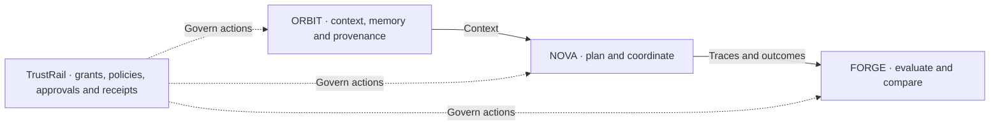

Context, coordination, evaluation and control. **ARIS** adds a standalone, mission-driven enterprise platform to this portfolio.

<table align="center">
<thead>
<tr class="header">
<th align="center">Project</th>
<th align="center">What I built</th>
<th align="center">Achieved results</th>
<th align="center">Explore</th>
</tr>
</thead>
<tbody>
<tr class="odd">
<td align="center"><strong>ARIS</strong></td>
<td align="center">Enterprise missions planned as task graphs, executed by specialised agents with human approval gates. First workflow: RFP response preparation.</td>
<td align="center"><strong>7</strong> specialised agents · <strong>26/26</strong> backend tests passed</td>
<td align="center">Private beta · RFP workflow verified with a scripted provider</td>
</tr>
<tr class="even">
<td align="center"><strong>NOVA</strong></td>
<td align="center">Agent orchestration with versioned skills, specialist agents, human approvals and editable artifacts.</td>
<td align="center"><strong>800</strong> deployed users · <strong>92%</strong> task success · <strong>−42%</strong> execution time</td>
<td align="center"><a href="https://github.com/yassineaqejjaj/NOVA">Code</a> · <a href="https://nova-six-orcin-96.vercel.app">Demo</a> · <a href="https://github.com/yassineaqejjaj/NOVA/blob/main/docs/PORTFOLIO_CASE_STUDY.md">Case study</a></td>
</tr>
<tr class="odd">
<td align="center"><strong>ORBIT</strong></td>
<td align="center">Governed retrieval and memory with access controls, provenance and context budgeting.</td>
<td align="center"><strong>91%</strong> retrieval precision@5 · <strong>−48%</strong> context tokens</td>
<td align="center"><a href="https://github.com/yassineaqejjaj/ORBIT">Code</a> · <a href="https://orbit-virid-psi-70.vercel.app">Demo</a> · <a href="https://github.com/yassineaqejjaj/ORBIT/blob/main/docs/PORTFOLIO_CASE_STUDY.md">Case study</a></td>
</tr>
<tr class="even">
<td align="center"><strong>FORGE</strong></td>
<td align="center">Agent evaluation with versioned scenarios, traces, human reviews and regression gates.</td>
<td align="center"><strong>96%</strong> known regression detection · <strong>89%</strong> LLM–human judge agreement</td>
<td align="center"><a href="https://github.com/yassineaqejjaj/FORGE">Code</a> · <a href="https://forge-pied-rho.vercel.app">Demo</a> · <a href="https://github.com/yassineaqejjaj/FORGE/blob/main/docs/PORTFOLIO_CASE_STUDY.md">Case study</a></td>
</tr>
<tr class="odd">
<td align="center"><strong>TrustRail</strong></td>
<td align="center">Grants, policies, human approvals and verifiable receipts for agent actions.</td>
<td align="center"><strong>18 ms</strong> P95 gateway overhead · <strong>100%</strong> policy tests passed</td>
<td align="center"><a href="https://github.com/yassineaqejjaj/TrustRail">Code</a> · <a href="https://trustrail-mu.vercel.app">Demo</a> · <a href="https://github.com/yassineaqejjaj/TrustRail/blob/main/docs/BUILD_STATUS.md">Build status</a></td>
</tr>
</tbody>
</table>

View IASEEN Constellation project banners

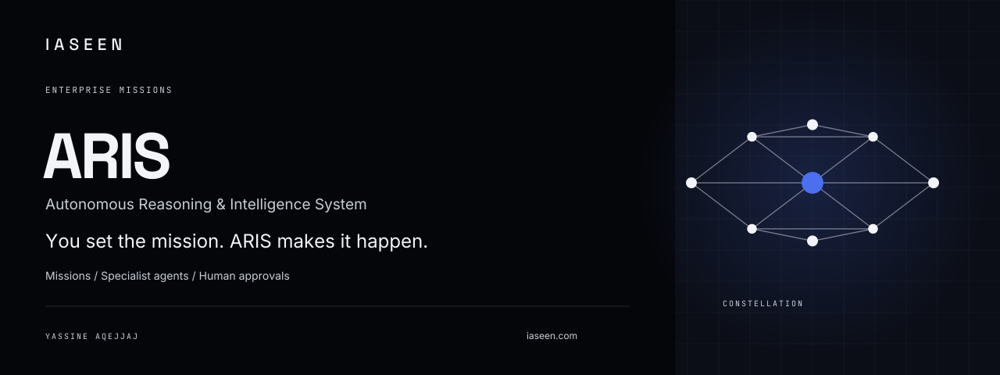

<table align="center">
<tr><td align="center" width="50%"></td><td align="center" width="50%"></td></tr>
<tr><td align="center" width="50%"></td><td align="center" width="50%"><a href="https://github.com/yassineaqejjaj/TrustRail">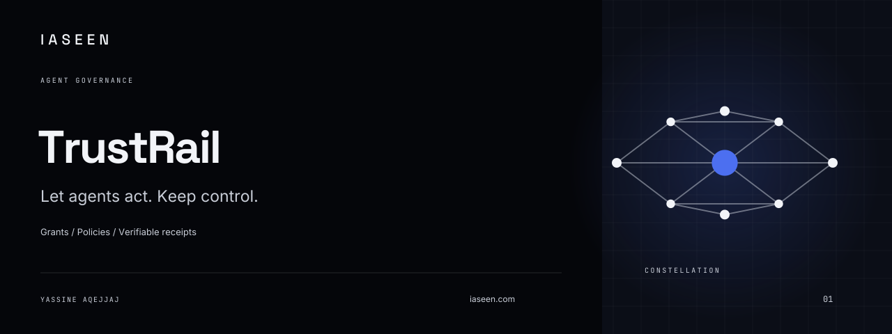</a></td></tr>
</table>

## HealthTech

Healthcare evaluation, care coordination and wellness. Public demos use synthetic data; each repository documents its deployment scope.

<table align="center">
<thead>
<tr class="header">
<th align="center">Project</th>
<th align="center">What it does</th>
<th align="center">Evidence / status</th>
</tr>
</thead>
<tbody>
<tr class="odd">
<td align="center"><strong><a href="https://github.com/yassineaqejjaj/medguard-ai">MedGuard AI</a></strong></td>
<td align="center">Evaluates healthcare AI applications, records human review and blocks failed release criteria.</td>
<td align="center"><a href="https://github.com/yassineaqejjaj/medguard-ai#see-it-work">Screenshots &amp; synthetic test workflow</a> · MVP</td>
</tr>
<tr class="even">
<td align="center"><strong><a href="https://github.com/yassineaqejjaj/CarePilot">M3aya Santé</a></strong></td>
<td align="center">Administrative patient-journey coordination with suggested actions awaiting human approval.</td>
<td align="center"><a href="https://carepilot-maroc.vercel.app">Public demo</a> · <a href="https://github.com/user-attachments/assets/f6f8542e-7ebe-4b5e-8892-dd34fc8fe758">Product walkthrough</a> · Synthetic data</td>
</tr>
<tr class="odd">
<td align="center"><strong>Vita</strong></td>
<td align="center">AI wellness and prevention coach for iOS and Android: weekly plans from phone and wearable data, with safety guardrails.</td>
<td align="center">Private repository · Complete prototype, not yet launched; not a medical device</td>
</tr>
</tbody>
</table>

View IASEEN Constellation project banners

<table align="center">
<tr><td align="center" width="50%"><a href="https://github.com/yassineaqejjaj/medguard-ai">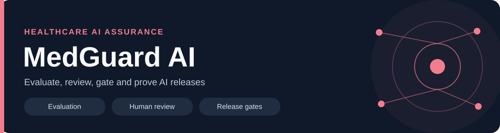</a></td><td align="center" width="50%"><a href="https://github.com/yassineaqejjaj/CarePilot">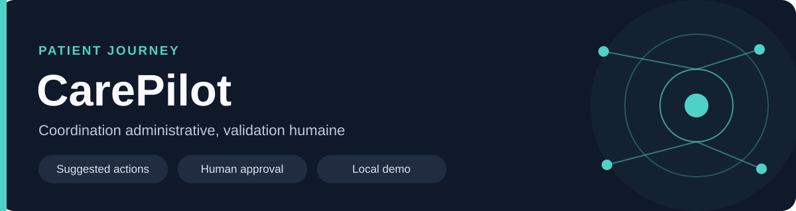</a></td></tr>
<tr><td align="center" width="50%">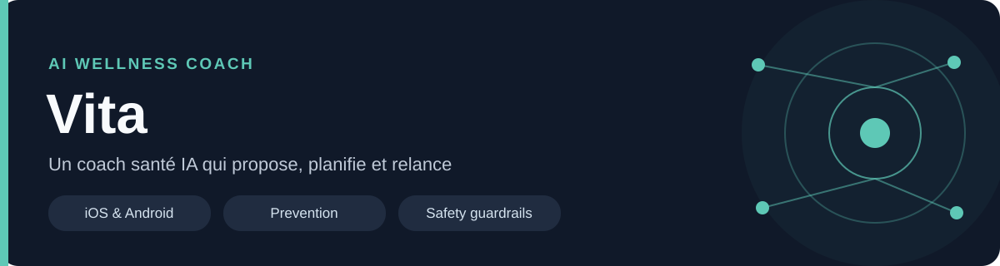</td></tr>
</table>

## EdTech

AI-supported learning, simulation and practical skills development, with human review and documented limits.

<table align="center">
<thead>
<tr class="header">
<th align="center">Project</th>
<th align="center">What it does</th>
<th align="center">Evidence / status</th>
</tr>
</thead>
<tbody>
<tr class="odd">
<td align="center"><strong><a href="https://github.com/yassineaqejjaj/SimuLearn">SimuLearn</a></strong></td>
<td align="center">Patient conversation practice and cited skills feedback for healthcare trainees.</td>
<td align="center"><a href="https://github.com/yassineaqejjaj/SimuLearn#23-parcours-apprenant">Product screens</a> · Mock-mode MVP; live integrations not yet validated</td>
</tr>
<tr class="even">
<td align="center"><strong><a href="https://github.com/yassineaqejjaj/ClassMind">ClassMind</a></strong></td>
<td align="center">Teacher-reviewed learning analytics and AI-supported mathematics exercises.</td>
<td align="center"><a href="https://github.com/yassineaqejjaj/ClassMind#captures-décran">Product screens</a> · French collège MVP, fictitious data</td>
</tr>
<tr class="odd">
<td align="center"><strong><a href="https://github.com/yassineaqejjaj/TRAIL-Academy">TRAIL Academy</a></strong></td>
<td align="center">Professional AI learning platform, modules, assessments and course commerce</td>
<td align="center">In development; external integrations and live payments not validated</td>
</tr>
<tr class="even">
<td align="center"><strong><a href="https://github.com/yassineaqejjaj/trail-intelligence">TRAIL Intelligence</a></strong></td>
<td align="center">AI skills intelligence: practice lab, evidence-linked assessments, human review and a verified skills passport, with privacy-preserving team analytics</td>
<td align="center"><a href="https://trail-intelligence.vercel.app">Web app</a> · In production; the AI evaluator is a keyword heuristic until an LLM is connected, so scores are provisional and uncalibrated</td>
</tr>
</tbody>
</table>

View IASEEN Constellation project banners

<table align="center">
<tr><td align="center" width="50%"><a href="https://github.com/yassineaqejjaj/SimuLearn">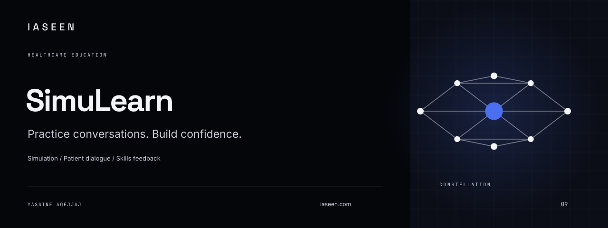</a></td><td align="center" width="50%"><a href="https://github.com/yassineaqejjaj/ClassMind">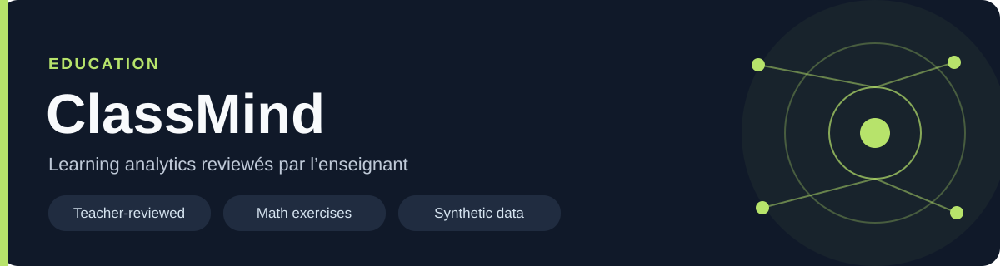</a></td></tr>
<tr><td align="center" width="50%"></td><td align="center" width="50%"></td></tr>
</table>

## Sportech

Tools for reviewing athletic performance and exploring race strategy.

<table align="center">
<thead>
<tr class="header">
<th align="center">Project</th>
<th align="center">What it does</th>
<th align="center">Evidence / status</th>
</tr>
</thead>
<tbody>
<tr class="odd">
<td align="center"><strong><a href="https://github.com/yassineaqejjaj/fencing-intelligence">Fencing Intelligence</a></strong></td>
<td align="center">Fencing video annotation and evidence-based performance analysis</td>
<td align="center"><a href="https://fencing-intelligence.vercel.app">Web preview</a> · Experimental heuristics</td>
</tr>
<tr class="even">
<td align="center"><strong><a href="https://github.com/yassineaqejjaj/apex-f1-pitwall">APEX F1 Pitwall</a></strong></td>
<td align="center">Race telemetry, replay, team radio and scenario-based strategy modelling</td>
<td align="center"><a href="https://apex-f1-pitwall.vercel.app">Web preview</a> · Estimates, not race predictions</td>
</tr>
</tbody>
</table>

View IASEEN Constellation project banners

<table align="center">
<tr><td align="center" width="50%"></td><td align="center" width="50%"></td></tr>
</table>

<!-- KPI-RESULTS:start -->
## Key results

Achieved outcomes across enterprise delivery, AI products, education and training.

View all achieved results

<table align="center">
<thead>
<tr class="header">
<th align="center">Project</th>
<th align="center">Results</th>
</tr>
</thead>
<tbody>
<tr class="odd">
<td align="center"><a href="https://iaseen.com/work/dila-sovereign-ai">DILA · Sovereign AI Platform</a></td>
<td align="center"><strong>−60%</strong> RAG delivery time reduction · <strong>0.94</strong> Answer faithfulness · <strong>75%</strong> Component reuse rate</td>
</tr>
<tr class="even">
<td align="center"><a href="https://iaseen.com/work/decathlon-ai-transformation">Decathlon · AI-Powered Retail</a></td>
<td align="center"><strong>×2.6</strong> Augmented productivity · <strong>93%</strong> Computer vision precision · <strong>4 M€</strong> Programme scope</td>
</tr>
<tr class="odd">
<td align="center"><a href="https://iaseen.com/work/carrefour-ml-mlops">Carrefour · Supply Chain Intelligence</a></td>
<td align="center"><strong>+13 pts</strong> Fill rate improvement · <strong>18% → 12%</strong> Forecasting WAPE · <strong>−35%</strong> Forecast processing time</td>
</tr>
<tr class="even">
<td align="center"><a href="https://github.com/yassineaqejjaj/NOVA">NOVA Suite</a></td>
<td align="center"><strong>800</strong> Deployed users · <strong>92%</strong> Task success rate · <strong>−42%</strong> Task execution time reduction</td>
</tr>
<tr class="odd">
<td align="center"><a href="https://github.com/yassineaqejjaj/NOVA">Nova Agents</a></td>
<td align="center"><strong>86%</strong> Task completion rate · <strong>92%</strong> Agent coordination success · <strong>81%</strong> Deliverables accepted without major revision</td>
</tr>
<tr class="even">
<td align="center"><a href="https://github.com/yassineaqejjaj/ORBIT">Nova Context (ORBIT)</a></td>
<td align="center"><strong>99.5%</strong> Temporal context accuracy · <strong>91%</strong> Context retrieval precision@5 · <strong>−48%</strong> Context token reduction</td>
</tr>
<tr class="odd">
<td align="center"><a href="https://github.com/yassineaqejjaj/FORGE">Nova Evals (FORGE)</a></td>
<td align="center"><strong>96%</strong> Known regression detection rate · <strong>89%</strong> LLM–human judge agreement · <strong>88%</strong> Automated evaluation coverage</td>
</tr>
<tr class="even">
<td align="center">ARIS (private beta)</td>
<td align="center"><strong>7</strong> Specialised agents · <strong>26/26</strong> Backend tests passed · RFP workflow verified with a scripted provider</td>
</tr>
<tr class="odd">
<td align="center"><a href="https://github.com/yassineaqejjaj/TrustRail">TrustRail</a></td>
<td align="center"><strong>100%</strong> Policy tests passed · <strong>18 ms</strong> P95 gateway overhead · <strong>100%</strong> Audit receipt generation</td>
</tr>
<tr class="even">
<td align="center"><a href="https://github.com/yassineaqejjaj/CarePilot">M3aya Santé</a></td>
<td align="center"><strong>9/9</strong> Care pathways covered · <strong>94%</strong> Workflow test success · <strong>−35%</strong> Administrative time reduction</td>
</tr>
<tr class="odd">
<td align="center"><a href="https://github.com/yassineaqejjaj/TRAIL-Academy">TRAIL Academy</a></td>
<td align="center"><strong>18</strong> Learning modules · <strong>82%</strong> Learning completion rate · <strong>70%</strong> Hands-on content</td>
</tr>
<tr class="even">
<td align="center"><a href="https://github.com/yassineaqejjaj/medguard-ai">MedGuard AI</a></td>
<td align="center"><strong>91%</strong> AI–expert evaluation agreement · <strong>96%</strong> Critical issue recall · <strong>100%</strong> Test audit coverage</td>
</tr>
<tr class="odd">
<td align="center"><a href="https://github.com/yassineaqejjaj/SimuLearn">SimuLearn</a></td>
<td align="center"><strong>24</strong> Simulation scenarios · <strong>87%</strong> Scenario completion rate · <strong>4.3/5</strong> User experience rating</td>
</tr>
<tr class="even">
<td align="center"><a href="https://github.com/yassineaqejjaj/ClassMind">ClassMind</a></td>
<td align="center"><strong>0.91</strong> Answer faithfulness · <strong>89%</strong> Curriculum alignment · <strong>−40%</strong> Lesson preparation time reduction</td>
</tr>
<tr class="odd">
<td align="center"><a href="https://github.com/yassineaqejjaj/fencing-intelligence">Fencing Intelligence</a></td>
<td align="center"><strong>91%</strong> Event detection precision · <strong>−60%</strong> Video review time reduction · <strong>3</strong> Fencing disciplines covered</td>
</tr>
<tr class="even">
<td align="center">LEAP</td>
<td align="center"><strong>1,500+</strong> Professionals trained · <strong>75+</strong> Training sessions delivered · <strong>4.6/5</strong> Training satisfaction</td>
</tr>
<tr class="odd">
<td align="center">Prompt Arena</td>
<td align="center"><strong>13</strong> Learning paths · <strong>130</strong> Applied challenges · <strong>76%</strong> Challenge success rate</td>
</tr>
</tbody>
</table>

_Calculation method, scope and measurement period available on request._

<!-- KPI-RESULTS:end -->

## Technical case studies

• <a href="https://github.com/yassineaqejjaj/NOVA/blob/main/docs/PORTFOLIO_CASE_STUDY.md"><strong>NOVA — Coordinated execution</strong></a>: orchestration, approvals, achieved task outcomes and execution time.

• <a href="https://github.com/yassineaqejjaj/ORBIT/blob/main/docs/PORTFOLIO_CASE_STUDY.md"><strong>ORBIT — Governed context</strong></a>: retrieval precision, temporal accuracy and context token reduction.

• <a href="https://github.com/yassineaqejjaj/FORGE/blob/main/docs/PORTFOLIO_CASE_STUDY.md"><strong>FORGE — Evaluation and regression control</strong></a>: evaluation coverage, judge agreement and known regression detection.

## How I build

**Specify → Architect → Build → Review → Verify → Release → Measure.**

I own the architecture, acceptance criteria, code review and release decisions. AI coding tools support implementation; autonomy grows with the checks that demonstrate the work meets the required standard.

• <strong>Define success first:</strong> specify the problem, constraints and acceptance criteria.

• <strong>Keep changes reviewable:</strong> build in small steps with clear module boundaries.

• <strong>Evaluate the whole system:</strong> combine tests, traces, scenario evaluations and human review.

• <strong>Measure after release:</strong> track quality, usage, cost and latency, then feed results into the next iteration.

[**Agentic SDLC framework**](https://github.com/yassineaqejjaj/agentic-sdlc) — autonomy levels, stage contracts, review checklists and release templates.

View the development lifecycle

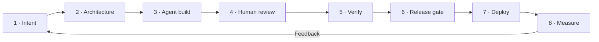

**Core stack:** Python · TypeScript · FastAPI · LangGraph · Fastify · React · Next.js · PostgreSQL · Docker · GitHub Actions · OpenTelemetry.

## The books

Books by Yassine Aqejjaj, connected to the projects and frameworks in this profile.

### SYMBIOSE

<a href="https://www.amazon.fr/dp/B0G48PY7S5">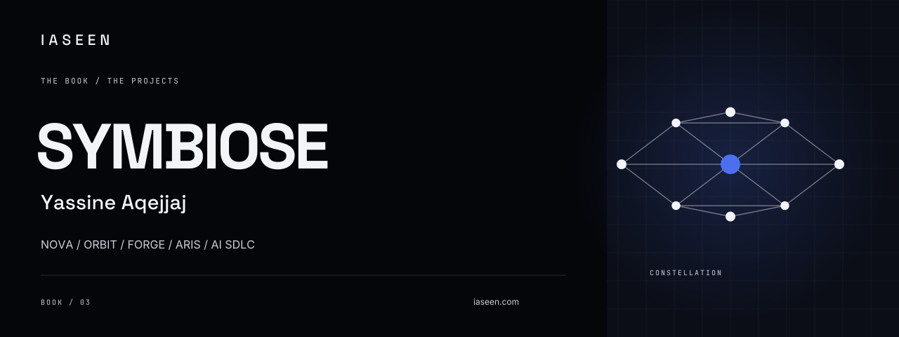</a>

**[Discover SYMBIOSE on Amazon →](https://www.amazon.fr/dp/B0G48PY7S5)**

**Related projects:** [NOVA](https://github.com/yassineaqejjaj/NOVA) · [ORBIT](https://github.com/yassineaqejjaj/ORBIT) · [FORGE](https://github.com/yassineaqejjaj/FORGE) · [ARIS (private)](https://github.com/yassineaqejjaj/ARIS) · [AI SDLC](https://github.com/yassineaqejjaj/agentic-sdlc)

NOVA coordinates agents · ORBIT supplies context and memory · FORGE evaluates · ARIS executes enterprise missions · AI SDLC structures the development lifecycle.

[Explore the book-to-project map →](https://github.com/yassineaqejjaj/agentic-sdlc/blob/main/docs/companion-books.md#symbiose)

<table align="center">
<tr>
<td align="center" width="50%"><a href="https://www.amazon.fr/dp/B0CN5PG7LT">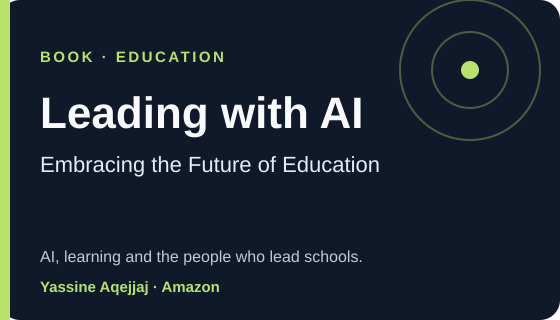</a> <strong>Education.</strong> <a href="https://www.amazon.fr/dp/B0CN5PG7LT">Leading with AI: Embracing the Future of Education</a> Code in practice: <a href="https://github.com/yassineaqejjaj/ClassMind">ClassMind</a> · <a href="https://github.com/yassineaqejjaj/SimuLearn">SimuLearn</a> · <a href="https://github.com/yassineaqejjaj/TRAIL-Academy">TRAIL Academy</a></td>
<td align="center" width="50%"><a href="https://www.amazon.fr/dp/B0CVB848M6">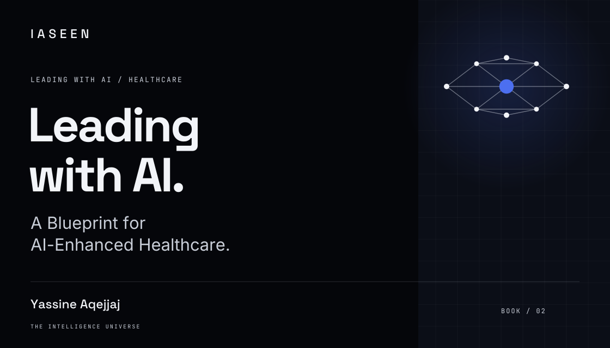</a> <strong>Healthcare.</strong> <a href="https://www.amazon.fr/dp/B0CVB848M6">Leading with AI: A Blueprint for AI-Enhanced Healthcare</a> Code in practice: <a href="https://github.com/yassineaqejjaj/medguard-ai">MedGuard AI</a> · <a href="https://github.com/yassineaqejjaj/CarePilot">M3aya Santé</a> · <a href="https://github.com/yassineaqejjaj/SimuLearn">SimuLearn</a></td>
</tr>
</table>

## Let's talk

<a href="mailto:yassine.aqejjaj@gmail.com">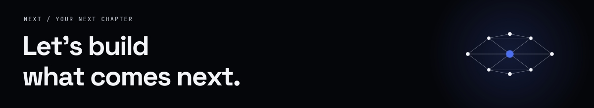</a>

<strong>AI leadership. Agentic platforms. Products worth building.</strong>

<a href="mailto:yassine.aqejjaj@gmail.com"><strong>Email me →</strong></a> &nbsp;·&nbsp;
<a href="https://iaseen.com">Explore my experience</a> &nbsp;·&nbsp;
<a href="https://github.com/yassineaqejjaj?tab=repositories">Browse the code</a>

IASEEN · THE INTELLIGENCE UNIVERSE

