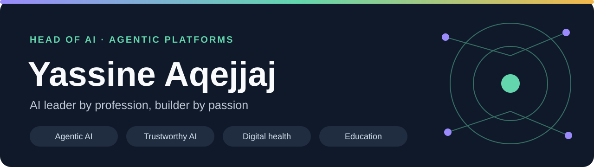
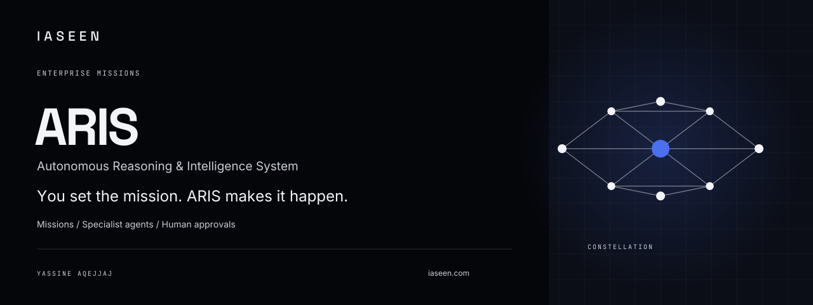
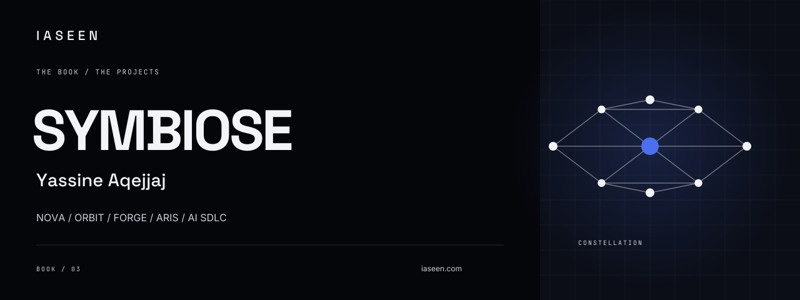

# IASEEN · Constellation

GitHub banner collection based on the IASEEN Constellation visual identity.

Void `#05060A` · Deep `#0B0E17` · Chrome `#C9CED8` · Light `#F2F4F8` · Electric `#4C6FF0`.

Space Grotesk (headings and wordmark), Inter (body), JetBrains Mono (labels). Letterforms are vector paths so GitHub renders the intended typography without external fonts. Each SVG is 1280 × 480 and includes accessible title and description elements.

## Profile

## TrustRail

[Repository](https://github.com/yassineaqejjaj/TrustRail) · [SVG source](https://github.com/yassineaqejjaj/TrustRail/blob/main/docs/assets/github-cover.svg)

## FORGE

[Repository](https://github.com/yassineaqejjaj/FORGE) · [SVG source](https://github.com/yassineaqejjaj/FORGE/blob/main/docs/assets/github-cover.svg)

## ORBIT

[Repository](https://github.com/yassineaqejjaj/ORBIT) · [SVG source](https://github.com/yassineaqejjaj/ORBIT/blob/main/docs/assets/github-cover.svg)

## NOVA

[Repository](https://github.com/yassineaqejjaj/NOVA) · [SVG source](https://github.com/yassineaqejjaj/NOVA/blob/main/docs/assets/github-cover.svg)

## Fencing Intelligence

[Repository](https://github.com/yassineaqejjaj/fencing-intelligence) · [SVG source](https://github.com/yassineaqejjaj/fencing-intelligence/blob/main/docs/assets/github-cover.svg)

## APEX F1 Pitwall

[Repository](https://github.com/yassineaqejjaj/apex-f1-pitwall) · [SVG source](https://github.com/yassineaqejjaj/apex-f1-pitwall/blob/main/docs/assets/github-cover.svg)

## M3aya Santé

[Repository](https://github.com/yassineaqejjaj/CarePilot) · [SVG source](https://github.com/yassineaqejjaj/CarePilot/blob/main/docs/assets/github-cover.svg)

## ClassMind

[Repository](https://github.com/yassineaqejjaj/ClassMind) · [SVG source](https://github.com/yassineaqejjaj/ClassMind/blob/main/docs/assets/github-cover.svg)

## SimuLearn

[Repository](https://github.com/yassineaqejjaj/SimuLearn) · [SVG source](https://github.com/yassineaqejjaj/SimuLearn/blob/main/docs/assets/github-cover.svg)

## MedGuard AI

[Repository](https://github.com/yassineaqejjaj/medguard-ai) · [SVG source](https://github.com/yassineaqejjaj/medguard-ai/blob/main/docs/assets/github-cover.svg)

## TRAIL Academy

[Repository](https://github.com/yassineaqejjaj/TRAIL-Academy) · [SVG source](https://github.com/yassineaqejjaj/TRAIL-Academy/blob/main/docs/assets/github-cover.svg)

## Agentic SDLC

[Repository](https://github.com/yassineaqejjaj/agentic-sdlc) · [SVG source](https://github.com/yassineaqejjaj/agentic-sdlc/blob/main/docs/assets/github-cover.svg)

## IASEEN

[Repository](https://github.com/yassineaqejjaj/iaseen) · [SVG source](https://github.com/yassineaqejjaj/iaseen/blob/main/docs/assets/github-cover.svg)

## TRAIL Intelligence

[Repository](https://github.com/yassineaqejjaj/trail-intelligence) · [SVG source](https://github.com/yassineaqejjaj/trail-intelligence/blob/main/docs/assets/github-cover.svg)

## ARIS

Private beta · enterprise missions, specialist agents and human approval gates.

[SVG source](assets/aris-cover.svg)

## SYMBIOSE

[Book on Amazon](https://www.amazon.fr/dp/B0G48PY7S5) · [SVG source](assets/book-symbiose.svg)

